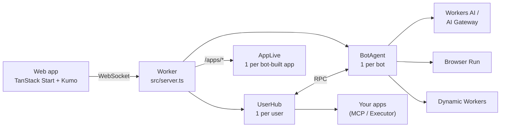
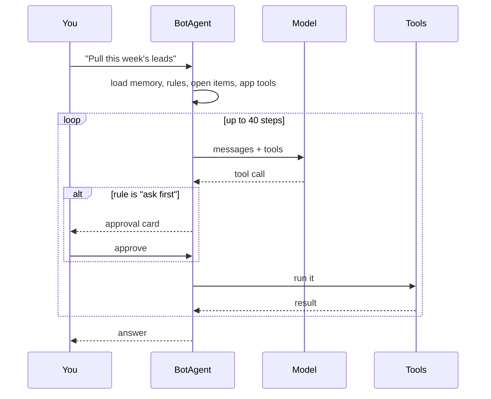
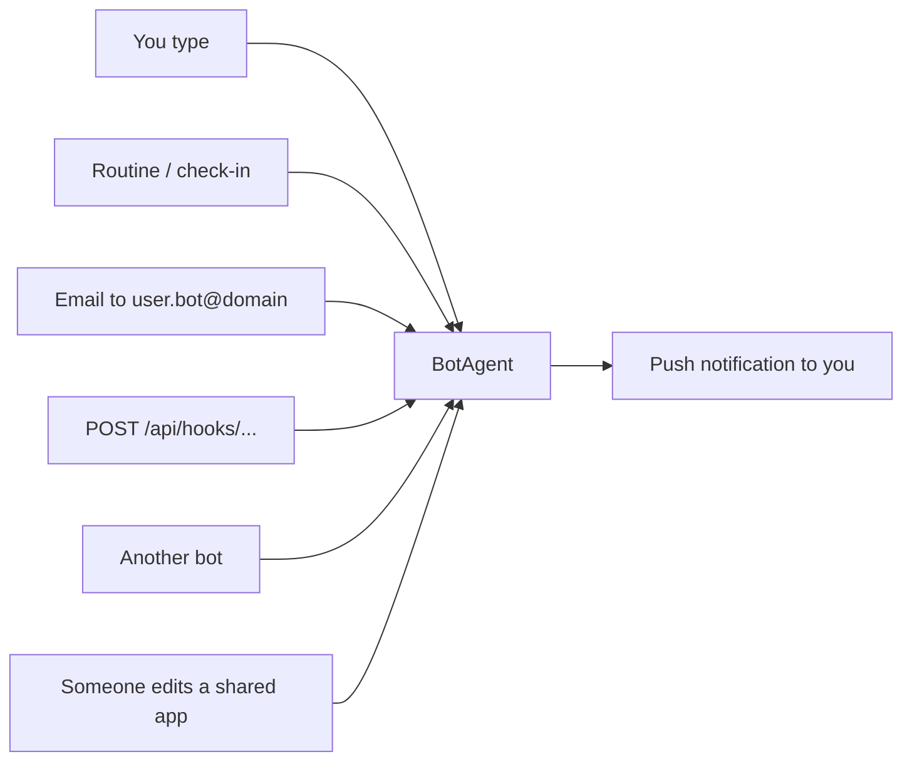

# Bots

AI teammates that each get their own computer and browser. Built entirely on
Cloudflare.

You create bots, give each one a job, and they work for you, even when
you're away. They ask before doing anything risky. When one needs a login,
it hands you its browser.

> [!NOTE]
> `@cloudflare/think`, `@cloudflare/computer`, the `cf` CLI and the
> Cloudflare Vite plugin 2.0 are preview or beta. Expect breaking changes.

## The big picture

One Worker runs everything. There are three kinds of Durable Objects:



| Durable Object | What it owns                                                        |
| -------------- | ------------------------------------------------------------------- |
| `UserHub`      | Your bot list, app connections, shared memory, push subscriptions    |
| `BotAgent`     | One bot: chat, memory, rules, routines, files, browser, secrets      |
| `AppLive`      | Live updates for a web app a bot built                              |

- Each bot keeps everything in its own SQLite. There's no separate database.
- You sign in to an app once, on the hub. Every bot uses that connection.
- The Worker only lets you reach your own hub and your own bots.

## What a bot can do

| Feature        | How it works                                                                 |
| -------------- | ---------------------------------------------------------------------------- |
| Chat           | Streaming, resumable turns. Names itself from your first task                |
| Computer       | Files in `/workspace` + a shell (`curl`, `jq`) in a Dynamic Worker. No container |
| Read the web   | Quick reads (markdown, extract, links, screenshot, PDF, crawl). Kitesurf first, Chromium fallback |
| Drive a browser| A real Chromium session you can watch live                                  |
| Take over      | Bot hands you its browser to sign in. You click **I'm done**, it continues   |
| Your apps      | Calls tools on connected MCP servers or Executor                             |
| Rules          | Per action type: allow, ask first, or block                                  |
| Routines       | Cron or one-off jobs. Can watch a URL/command and only wake when it changes   |
| Check-ins      | Wakes every few hours, speaks only if something's worth saying             |
| Memory         | Its own memory + one shared across all your bots. Both have version history  |
| Open items     | Tracks things it's waiting on until they're resolved                         |
| Other bots     | Messages and files to other bots                                             |
| Web apps       | Builds small sites (trackers, dashboards) on its own data, shareable by link |
| Teach by demo  | Records you doing a task in its browser, saves it as a skill                 |
| Secrets        | You type an API key in a masked card. The bot uses it but never sees it      |
| Wake-ups       | Inbound email, webhooks, and push notifications to you                       |

## How a turn works



- A loop guard stops the bot from repeating the same call over and over.
- Unanswered approvals get a push reminder after 4 hours and close after 24.
- Background turns (routines, check-ins, email, webhooks) can use a cheaper
  model via `BACKGROUND_MODEL`.

## Rules

Each bot has one setting per action type:

| Action type       | Default   |
| ----------------- | --------- |
| Edit files        | allow     |
| Run commands      | allow     |
| Read the web      | allow     |
| Drive the browser | allow     |
| Use connected apps| ask first |
| Message other bots| allow     |
| Schedule routines | allow     |

Nobody is around to approve a background turn. So by default it can only use
app tools that are read-only.

## Ways to wake a bot



## Stack

| Layer      | What we use                                                   |
| ---------- | ------------------------------------------------------------- |
| Runtime    | Cloudflare Workers, Durable Objects (SQLite)                  |
| Agents     | `agents` SDK, `@cloudflare/think`, `@cloudflare/computer`     |
| Models     | Workers AI, or any provider through AI Gateway                |
| Browser    | Browser Run: Chromium, Live View, Kitesurf                    |
| Sandboxing | Dynamic Workers (shell, bot-built app servers)                |
| Inbound    | Email Routing, webhooks, Web Push                             |
| Frontend   | TanStack Start, React 19, Tailwind v4, Kumo, Hugeicons        |
| Tooling    | `cf` CLI, Vite, Vitest, pnpm                                  |

## Run it locally

```bash
npm i -g cf
```

```bash
pnpm install
```

```bash
npx wrangler login
```

```bash
pnpm dev
```

Then open http://localhost:3000.

- **Why Wrangler login?** Workers AI and Browser Run can't run locally, so dev
  calls your real account for those two. Everything else runs on disk under
  `.cloudflare/state/`.
- **More than one account?** Prefix with `CLOUDFLARE_ACCOUNT_ID=<id>`.
- **Secrets:** copy `.dev.vars.example` to `.dev.vars`. All of them are
  optional.

## Deploy

```bash
cf auth login
```

```bash
pnpm run deploy
```

> [!WARNING]
> Without Cloudflare Access in front, every visitor is the same `demo` user.
> Put the Worker behind Access before sharing it. Add a bypass for
> `/api/hooks/*` and `/apps/*`, because those use a token in the URL. See
> `src/lib/auth.ts`.

## Configuration

Set in `cloudflare.config.ts`. Only `MODEL` matters to get started.

| Setting                  | What it does                                                         |
| ------------------------ | -------------------------------------------------------------------- |
| `MODEL`                  | Chat model. `@cf/...` = Workers AI. `provider/model` = AI Gateway     |
| `BACKGROUND_MODEL`       | Model for background turns. Empty = same as `MODEL`                  |
| `AI_GATEWAY_ID`          | Route Workers AI through a gateway too (logs, spend limits)          |
| `QUICK_ACTION_ENGINE`    | `kitesurf` (cheaper) or `chromium` for quick page reads               |
| `EMAIL_DOMAIN`           | Turns on inbound email. Each bot gets `<user>.<bot>@<domain>`        |
| `BROWSER_RUN_ACCOUNT_ID` | With `BROWSER_RUN_API_TOKEN` (secret), turns on the crawl tool       |
| `VAPID_*`                | Push notification keys (`npx web-push generate-vapid-keys`)          |

## Project layout

```
src/
  server.ts           Worker entry: auth, /agents/*, /apps/*, inbound email
  agents/
    user-hub.ts       one per user: bot list, connections, shared memory, push
    bot-agent.ts      one per bot: tools, rules, routines, computer, browser
    prompt.ts         the bot's system prompt
    web-tools.ts      quick web read tools
    apps-runtime.ts   serves bot-built apps + AppLive
    app-store.ts      app data and share links
    teach.ts          records a demo in the browser
    secrets.ts        credentials the bot never sees
    guards.ts         stops runaway loops
    memory.ts         memory helpers
  routes/
    _app/             bot thread, computer + settings panels, connections
    api/hooks.*.ts    webhook endpoint
  components/         thread, Computer card, sidebar, panels
  lib/                shared types, server functions, React contexts
cloudflare.config.ts  Worker config and bindings
product.md            full product spec
AGENTS.md             read this first if you're an AI coding agent
```

## Scripts

| Command           | What it does                            |
| ----------------- | --------------------------------------- |
| `pnpm dev`        | Dev server on :3000, running on workerd |
| `pnpm build`      | Production build                        |
| `pnpm run deploy` | Build and deploy                        |
| `pnpm test`       | Vitest                                  |
| `pnpm typecheck`  | Regenerate binding types, then `tsc`    |
| `pnpm format`     | Prettier                                |
